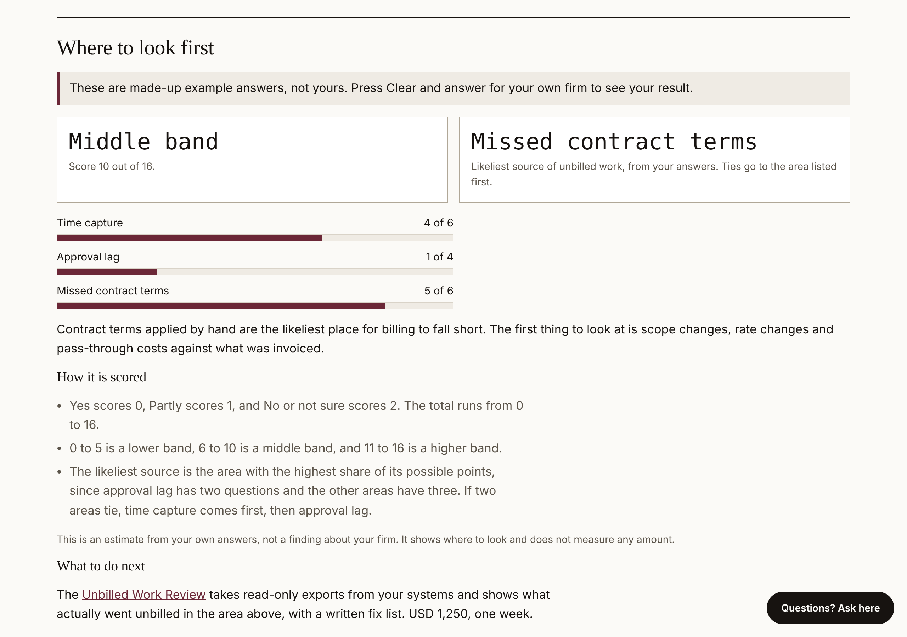

# Unbilled Work Finder

**Free. Eight questions. No dollar figures. Your answers stay in your browser.**

**Run it:** https://saintilco.com/unbilled-work-finder.html

For services firms that suspect work is going unbilled but have no export to hand. Eight questions across three areas show which one is the likeliest source:

- Time capture (3 questions)
- Approval lag (2 questions)
- Missed contract terms (3 questions)

## How it is scored

Shown in full on the page:

- Yes scores 0, Partly 1, No or Not sure 2. The total runs from 0 to 16.
- 0 to 5 is the lower band, 6 to 10 the middle band, 11 to 16 the higher band.
- The likeliest source is the area with the highest share of its possible points. Ties go to time capture first, then approval lag.

The result is an estimate from your own answers, not a finding about your firm.

## Sample

`samples/example-answers.md` holds the made-up example answers behind the "Try example answers" button and the result they give.

## How it is tested

Checked in Chrome against the live build on 11 November 2026. All 8 scenarios passed:

| Scenario | Expected and seen |
|---|---|
| All Yes | Lower band, 0 of 16 |
| All No | Higher band, 16 of 16 |
| Example answers | Middle band, 10 of 16, missed contract terms |
| Time capture answers only | Middle band, 6 of 16, time capture |
| All Partly (three-way tie) | 8 of 16, time capture wins the tie |
| Band edges | 5 is lower, 10 is middle, 11 is higher |

## What this repository is

A showcase: what the tool does, what it looks like, made-up sample files to try it with, and how it is checked. The tool itself runs on saintilco.com. **No source code, test suites or answer keys are published here.**

Everything in `samples/` is fictional. No client data, real names or real figures appear anywhere in this repository.

## About

Built by [Saintilco Consulting](https://saintilco.com), independent Workday Financials controls reviews. Saintilco Consulting is not affiliated with, sponsored by, or endorsed by Workday, Inc. WORKDAY is a trademark of Workday, Inc. Commercial and systems guidance only, not legal, tax, accounting or audit advice.

Copyright 2026 Saintilco Consulting. All rights reserved. No license is granted to copy, modify or redistribute the tool or this material.
